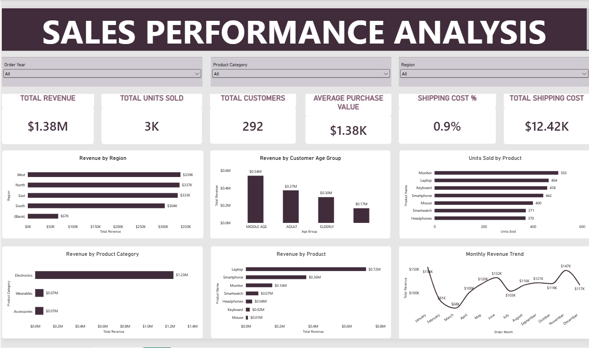

# Sales Performance & Customer Insights Dashboard

## Project Overview

This project is a complete retail sales analysis built to understand how a business is performing across revenue, products, product categories, customers, regions, purchasing patterns, and shipping costs.

The project started with a raw retail dataset that required cleaning, validation, transformation, and preparation before it could be used for analysis. I used Excel and Power Query to prepare the data, then built an interactive Power BI dashboard to turn the cleaned data into business insights.

The main goal was to approach the analysis from a management and stakeholder perspective. Instead of only asking what the data contains, the project focuses on questions such as:

**What is driving revenue? Which products and customers are most valuable? Where is the business performing best? Where are there data-quality problems? And what actions could management take based on the findings?**

---

## Business Objective

The objective of this project was to transform raw retail sales data into a reliable and easy-to-understand reporting solution that can help management:

- Monitor overall sales performance
- Understand revenue trends over time
- Identify high-performing products
- Compare product categories
- Evaluate regional performance
- Understand revenue contribution by customer age group
- Measure average purchase value
- Monitor units sold
- Review shipping costs
- Identify important data-quality issues
- Make practical business decisions from the analysis

---

## Business Questions

The dashboard was designed around ten key business questions:

1. How is revenue performing over time?
2. Which products generate the most revenue?
3. Which product categories contribute the most revenue?
4. Which regions generate the most revenue?
5. Which customer age groups contribute the most revenue?
6. What is the average purchase value?
7. Which products sell the highest number of units?
8. What can the available shipping data tell management about operations?
9. Where are the major data-quality issues?
10. What actions should management take based on the findings?

---

# Dataset and Data Preparation

The dataset contains retail transaction information such as customer details, purchase dates, product information, prices, quantities, total prices, shipping information, and other customer attributes.

Before building the dashboard, I first inspected the dataset for missing values, inconsistent values, incorrect data types, duplicate or repeated customer records, and calculation errors.

The data preparation process was completed mainly with **Excel and Power Query**.

The overall process was:

**Raw Data → Data Profiling → Data Cleaning → Data Validation → Calculations → Power BI Analysis → Dashboard → Insights and Recommendations**

---

# Initial Data Profiling and Data Quality Checks

Before transforming the dataset, I profiled the columns to understand missing values, data types, and the general quality of the raw data.

The initial profiling identified:

---

# Data Cleaning and Transformation


### Missing Values Identified

The profiling process identified missing values in several important fields:

- Region: 50 blank rows
- Age: 100 blank rows
- Shipping Status: 50 blank rows

These blanks were deliberately retained rather than filled with assumptions. An important reason is that the affected rows still contained useful and important information in other columns. Removing those rows would have caused the loss of valid sales, customer, product, financial, or operational information that could still be used in the analysis.

The missing values also could not be reliably inferred from the available data. Instead of inventing values or deleting otherwise useful records, the blanks were preserved so that the dataset remained as close as possible to the original data. This also allowed the dashboard to clearly expose data-completeness issues as part of the data-quality findings.

This follows an important data-cleaning principle: missing information should not automatically lead to deleting an entire record when the remaining fields contain valuable information. When the correct value cannot be confidently determined, retaining the blank is often more appropriate.

## Data Type Corrections

During data preparation, I reviewed the data types of the financial columns.

The following fields were changed from **Decimal Number** to **Currency**:

- `Shipping Fee`
- `Unit Price`
- `Total Price`

This was done so that the monetary fields were represented consistently as financial values in the prepared dataset and Power BI report.

---

## 1. Checking the Total Price

One of the important data-quality checks was to verify whether the original `Total Price` was consistent with:

**Unit Price × Quantity**

I created a validation column in Excel using:

```excel
=IF(I2=G2*H2,"Correct","Mismatch")
```

This allowed me to identify records where the original total price did not agree with the unit price and quantity.

The check identified **20 records with Total Price mismatches**.

Instead of deleting the original values, I kept the source data and created a separate corrected field. This preserves the original information while providing a reliable value for analysis.

The corrected value was calculated using:

```excel
=ROUND(G2*H2,2)
```

The resulting field was named **Corrected Total Price**.

I used `Corrected Total Price` for the revenue calculations in the Power BI dashboard.

This approach makes the correction transparent and allows the original data to remain available for comparison.

---


## Dataset Column Headers

The dataset contains 18 columns covering customer information, product details, sales values, shipping information, and analysis fields created during the cleaning process.

| Column Header | Short Description |
|---|---|
| **Customer ID** | Identifier used to identify each customer. |
| **Gender** | Gender recorded for the customer. |
| **Region** | Geographic region associated with the customer or purchase. |
| **Age** | Age of the customer. |
| **Product Name** | Name of the product purchased. |
| **Category** | Product category to which the item belongs. |
| **Unit Price** | Selling price of one unit of the product. |
| **Quantity** | Number of units purchased. |
| **Total Price** | Original total purchase amount recorded in the dataset. |
| **Shipping Fee** | Cost charged for shipping the purchase. |
| **Shipping Status** | Recorded status of the shipment or delivery. |
| **Order Date** | Date on which the purchase/order was made. |
| **Age Group** | Age classification created from Age: Adult, Middle Age, or Elderly. |
| **Order Month** | Month extracted from Order Date for monthly analysis. |
| **Total Price Check** | Validation field used to check whether Total Price matches Unit Price × Quantity. |
| **Corrected Total Price** | Recalculated total based on Unit Price × Quantity, used for the final revenue analysis. |
| **Order Year** | Year extracted from Order Date for yearly analysis. |
| **Month Number** | Numeric month value used to arrange Order Month in chronological order. |


## 2. Creating Customer Age Groups

The original dataset contained individual customer ages. To make the analysis easier to understand from a business perspective, I created an **Age Group** column.

The formula I used was:

```excel
=IFS(TRIM(D2&"")="","",D2<=40,"ADULT",D2<=60,"MIDDLE AGE",D2>60,"ELDERLY")
```

The logic was:

- Age 40 and below → **ADULT**
- Age 41 to 60 → **MIDDLE AGE**
- Age above 60 → **ELDERLY**
- Blank or whitespace-only age → remains **blank**

The `TRIM(D2&"")=""` part was important because some cells that appeared blank contained spaces or other text-like values. Without handling these values, they could incorrectly be classified as an age group.

This allowed the dashboard to compare revenue across meaningful customer age segments without incorrectly assigning missing ages to a group.

---

## 3. Validating Customer Count

Customer records can appear more than once in a sales dataset, so simply counting rows would not necessarily give the number of individual customers.

For the final Power BI dashboard, I used a distinct customer count so that each Customer ID was counted once.

The measure used was:

```DAX
Total Customers =
DISTINCTCOUNT('Sales Data'[Customer ID])
```

The final dashboard shows:

**292 unique customers**

This gives a more meaningful customer KPI than simply counting transaction records.

---

## 4. Creating the Average Purchase Value

The dashboard uses **Average Purchase Value (APV)** to represent the average value of a purchase record.

The measure is based on the average of `Corrected Total Price`.

The final Average Purchase Value is:

**$1,378.79**

APV is used consistently throughout this project as the KPI name.

---

## 5. Creating and Sorting the Order Month

The dataset contained an `Order Month` field with month names such as January, February, March, and so on.

Because month names are text values, Power BI can sort them alphabetically instead of chronologically.

To solve this, I created a **Month Number** field from the purchase date and used it to sort `Order Month`.

The final dashboard therefore displays the monthly revenue trend correctly:

**January → February → March → April → May → June → July → August → September → October → November → December**

This was important because the purpose of the visual is to show the actual movement of revenue over time, not to rank months alphabetically.

---

# Power BI Dashboard

After completing the cleaning and validation process, the prepared dataset was loaded into Power BI.

The dashboard was designed to give management a quick overview first, followed by deeper analysis.

The top section contains the main KPIs:

| KPI | Final Result |
|---|---:|
| Total Revenue | $1.38M |
| Total Units Sold | 3K |
| Total Customers | 292 |
| Average Purchase Value | $1,378.79 |
| Shipping Cost % | 0.9% |
| Total Shipping Cost | $12,416.39 |

The dashboard also includes three main slicers:

**Order Year, Product Category, and Region**

The analytical visuals include:

- Revenue by Region
- Revenue by Customer Age Group
- Units Sold by Product
- Revenue by Product Category
- Revenue by Product
- Monthly Revenue Trend

The dashboard was intentionally kept focused rather than filling the page with unnecessary visuals. Each visual was included because it helps answer one or more of the business questions defined for the project.

---

# Key Findings

## Overall Revenue Performance

The business generated approximately **$1.38 million in total revenue** from the analyzed dataset.

Total units sold were approximately **3,000**, while the dashboard identified **292 unique customers**.

The Average Purchase Value was **$1,378.79**.

These KPIs provide the starting point for understanding the overall scale of the business before moving into product, customer, regional, and time-based analysis.

---

## Product Category Performance

Electronics is by far the largest revenue-generating category.

| Product Category | Revenue |
|---|---:|
| Electronics | $1,231,618.16 |
| Wearables | $74,200.00 |
| Accessories | $72,973.04 |

Electronics contributes approximately **89% of total revenue**.

This shows that the business is heavily dependent on Electronics for its revenue generation.

From a management perspective, this makes the Electronics category both a major strength and a concentration risk. Strong performance in this category is important to overall revenue, but the business could also benefit from developing the smaller categories.

---

## Product Revenue Performance

The strongest products by revenue were:

| Product | Revenue |
|---|---:|
| Laptop | ~$0.72M |
| Smartphone | ~$0.36M |
| Monitor | ~$0.16M |
| Smartwatch | ~$0.07M |
| Headphones | ~$0.04M |
| Keyboard | ~$0.02M |
| Mouse | ~$0.01M |

The **Laptop** is the strongest revenue-generating product in the dataset, followed by the Smartphone and Monitor.

This shows that high sales volume and high revenue are not always the same thing, which is why the dashboard analyzes both revenue and units sold.

---

## Units Sold by Product

The products with the highest unit sales were:

| Product | Units Sold |
|---|---:|
| Monitor | 503 |
| Laptop | 464 |
| Keyboard | 458 |
| Smartphone | 442 |
| Mouse | 400 |
| Smartwatch | 371 |
| Headphones | 370 |

The **Monitor** has the highest number of units sold at 503 units.

The Laptop, however, generates considerably more revenue despite having fewer units sold than the Monitor. This demonstrates the importance of looking at both **sales volume and revenue contribution** when evaluating product performance.

---

## Regional Performance

Revenue by region was:

| Region | Revenue |
|---|---:|
| West | $338,605.71 |
| North | $336,578.84 |
| East | $332,525.29 |
| South | $303,722.60 |
| Blank | $67,358.76 |

The **West** region generated the highest identified regional revenue at approximately **$338.6K**.

The regional results are relatively close among West, North, East, and South. However, the dataset also contains approximately **$67.4K of revenue where regional information is missing**.

This missing information is important because it means the regional analysis does not represent the full dataset with complete geographic attribution.

The original data profiling identified **50 blank Region rows**.

---

## Customer Age Group Performance

Revenue by age group was:

| Age Group | Revenue |
|---|---:|
| Middle Age | $541,367.19 |
| Adult | $373,858.20 |
| Elderly | $295,550.51 |
| Blank | $168,015.30 |

The **Middle Age** group contributes the highest identified revenue at approximately **$541.4K**.

There is also approximately **$168K associated with missing age-group information**.

The original data profiling identified **100 blank Age rows**.

This means the Middle Age segment is currently the strongest identifiable customer segment, but improved customer demographic data would make the analysis more complete.

---

## Monthly Revenue Performance

The corrected monthly trend shows the following pattern:

| Month | Revenue |
|---|---:|
| January | ~$154K |
| February | ~$81K |
| March | ~$68K |
| April | ~$100K |
| May | ~$120K |
| June | ~$132K |
| July | ~$103K |
| August | ~$116K |
| September | ~$121K |
| October | ~$119K |
| November | ~$147K |
| December | ~$117K |

January recorded the highest monthly revenue at approximately **$154K**, while March recorded the lowest at approximately **$68K**.

The significant difference between stronger and weaker months suggests that management could investigate seasonal demand, inventory availability, promotions, pricing, or other factors that may explain these changes.

---

## Shipping Performance

Total shipping cost was approximately **$12,416.39**, representing approximately **0.9% of total revenue**.

The initial data profiling identified **50 blank Shipping Status rows**.

Based on the available data, shipping cost is relatively small compared with total revenue. However, the missing Shipping Status values mean that shipping-status analysis is not completely representative of all records.

The available dashboard does not provide enough detail to fully evaluate delivery time, delays, or operational shipping efficiency.

---

# Business Recommendations

## Protect the Electronics Revenue Base

Electronics is responsible for the overwhelming majority of revenue. Management should therefore pay close attention to inventory availability, pricing, product quality, and customer demand within this category.

A disruption in Electronics performance could have a significant impact on total business revenue.

## Focus on High-Value Products

Laptops and Smartphones are major revenue contributors.

Management should prioritize these products when considering inventory planning, promotions, pricing decisions, and availability.

## Use Cross-Selling to Grow Smaller Categories

Wearables and Accessories generate significantly less revenue than Electronics.

The business could increase their contribution by creating complementary product bundles such as:

**Laptop + Accessories**

**Smartphone + Wearable**

**Monitor + Keyboard + Mouse**

This can encourage customers to purchase related products alongside higher-value Electronics.

## Investigate the March Revenue Decline

March is the weakest month in the dataset.

Management should investigate whether the decline was related to inventory availability, customer demand, promotions, pricing, product performance, or operational factors.

Understanding the reason for the decline could help reduce similar performance gaps in the future.

## Target the Strongest Customer Segment

The Middle Age customer segment contributes the highest identified revenue.

This segment could be targeted with personalized offers, relevant product recommendations, loyalty initiatives, and focused marketing campaigns.

## Improve Data Completeness

The initial data profiling identified **50 blank Region rows, 100 blank Age rows, and 50 blank Shipping Status rows**.

The business should improve the way customer and transaction information is collected so that future dashboards can provide more complete regional, demographic, and operational analysis.

## Continue Monitoring Shipping

Although shipping cost represents only about 0.9% of revenue, management should continue monitoring shipping performance and consider analyzing delivery status, delays, and shipping cost by region and product category if additional data becomes available.

---

# Data Quality Findings

One of the important outcomes of this project was identifying that data quality directly affects business reporting.

The initial profiling found:

- **50 blank Region rows**
- **100 blank Age rows**
- **50 blank Shipping Status rows**

The analysis also identified **20 Total Price inconsistencies**, where:

**Unit Price × Quantity did not equal the original Total Price.**

Rather than hiding the issue, the records were identified, the original values were preserved, and a separate `Corrected Total Price` field was created for analysis.

The blank values were not replaced with assumptions. Instead, they were retained so that their effect could be recognized in the final analysis.

These findings demonstrate why data cleaning and validation should happen before building a dashboard. A visually attractive dashboard can still produce misleading conclusions if the underlying data has not been checked.

---

# Limitations

This project has several limitations that should be considered when interpreting the results.

The dataset does not contain an Order ID, so the analysis is based on purchase records rather than uniquely identified orders.

The dataset contains **50 blank Region rows, 100 blank Age rows, and 50 blank Shipping Status rows**. These missing values reduce the completeness of geographic, demographic, and shipping-status analysis.

Twenty records contained inconsistencies between Unit Price, Quantity, and the original Total Price. These were addressed by creating a separate Corrected Total Price field rather than overwriting the original source values.

Shipping analysis is also limited because the available information does not provide enough detail to fully evaluate delivery time, delays, or operational shipping efficiency.

Finally, this project is a portfolio case study based on the available dataset. The findings should therefore be interpreted within the scope of the data rather than treated as a complete representation of a real company's entire business.

---

# Tools Used

**Microsoft Excel** was used for initial data inspection, validation, calculations, and preparation.

**Power Query** was used for data profiling, cleaning, transformation, handling missing values, correcting data types, and preparing the dataset for analysis.

**Power BI** was used to build the interactive dashboard and communicate the analysis visually.

**DAX** was used to create analytical measures such as the distinct customer count.

**GitHub** is used to document and present the completed project as part of my data analytics portfolio.

---

# Project Structure

```text
Sales-Performance-Customer-Insights/
│
├── README.md
│
├── Power BI/
│   └── Sales_Performance_Analysis.pbix
│
├── Images/
│   └── Sales Performance Dashboard.png
│
└── Documentation/
    └── Data Cleaning Notes.md
```

---

# Skills Demonstrated

This project demonstrates practical experience in:

**Excel:** formulas, data validation, calculations, and data preparation.

**Power Query:** data profiling, cleaning, transformation, handling missing values, correcting data types, and creating analytical columns.

**Power BI:** dashboard design, KPI development, slicers, interactive reporting, and business-focused data visualization.

**DAX:** distinct customer calculations and analytical measures.

**Data Analysis:** identifying trends, comparing performance, investigating data-quality issues, and translating numbers into business insights.

**Business Intelligence:** presenting information in a way that supports management decision-making.

**GitHub:** documenting and presenting an end-to-end analytics project.

---

# Future Improvements

If more business data becomes available, this project could be extended with Order IDs, profit and margin data, discounts, customer retention, repeat purchases, delivery times, shipping status analysis, customer lifetime value, and year-over-year performance.

Additional analysis could also examine profitability rather than revenue alone. This would help determine whether the products generating the most revenue are also the most profitable.

---

# Final Conclusion

This project demonstrates an end-to-end approach to retail data analysis.

I started by profiling the raw dataset and identifying missing values, data-type issues, and calculation inconsistencies. I then cleaned and transformed the data, changed the relevant financial fields to Currency, created meaningful customer age groups, validated customer counts, corrected inconsistent Total Price values through a separate Corrected Total Price field, and prepared the data for Power BI.

The final dashboard shows that the business is heavily driven by Electronics, with Laptops being the strongest revenue-generating product and Monitors leading in unit sales. The West region generates the highest identified regional revenue, while the Middle Age customer group contributes the highest identified age-group revenue. January is the strongest month, while March is the weakest.

At the same time, the project highlights important data-quality issues, including 50 blank Region rows, 100 blank Age rows, 50 blank Shipping Status rows, and 20 Total Price inconsistencies.

The main business takeaway is that management should **protect the strongest revenue drivers while improving data quality and developing strategies to increase the contribution of smaller categories and weaker-performing periods.**

This project demonstrates not just the ability to build a Power BI dashboard, but the ability to take data from **raw and imperfect information to profiling, cleaning, validation, analysis, visualization, business insights, and actionable recommendations.**

---

## Author

**Darlington**

Aspiring Data Analyst | Business Intelligence | Power BI | Excel | Data Analytics
